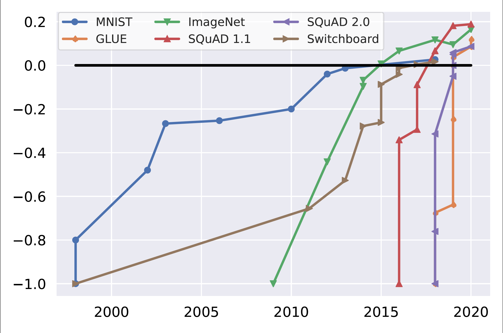

# Benchmarking

## Table of Contents
1. [Evaluation](#evaluation)
2. [Problems in the Water](#problems-in-the-water)
3. Using historical data as a solution
4. Shrinking the benchmark as a solution
5. Using dynamic benchmarks as a solution

**benchmark**
[noun]
A standard point of reference against which things can be compared. A benchmark consists of dataset(s), metric(s), and a way to aggregate performance.

## Evaluation
Human evaluation is the gold standard in many NLP tasks but it suffers from prohibitive costs and poor scalability [(Zouhar et al, 2026)](http://arxiv.org/abs/2501.18251). In the absence of human supervision, researchers rely on benchmarking and automated metrics [(Zouhar et al, 2026)](http://arxiv.org/abs/2501.18251). 

It comes to no surprise then dayasets are the telescopes of our field (Joshi); without reliable benchmarks, we are just like "astronomers wanting to see the stars but refusing to build telescopes" (Joshi). AI benchmarks have become the primary instrument for evaluating model capabilities, comparing AI systems, and informing deployment decisions [(Jiang et al, 2026)](?).

## Problems in the Water
### Inaccurate
Benchmarks often fail to measure the intended capability. Evaluation quality can degrade due to labelling errors and benchmark saturation.

**Saturation** Recent models have "outpaced the benchmarks [that] test them" [(AI Index Report, 2021)](?). 

Benchmark saturation over time for popular benchmarks. Initial performance and human performance are normalized to -1 and 0, respectively [(Kiela et al, 2021)](?)

**Labelling Errors**

**Reward Hacking**

### Expensive
**Energy** Evaluating generative AI models is a routine but resource-intensive, process that is conducted over and over again during the course of model development [(Fisch et al, 2026)](http://arxiv.org/abs/2607.05046). In the case of multilingual benchmarks, exhaustive evaluation scles linearly with the number of languages, making it prohibitively expensive to evaluate all LLMs on all samples [[Wu et al, 2025](https://arxiv.org/abs/2504.15521); [Lior et al, 2026](https://arxiv.org/abs/2606.15643)].

**Data** Benchmarks require so much so much data that it sidelines low-resource languages. Multilingual models are evaluated only on a small subset of languages. There is no guarantee that performance on English-Spanish, the only common evaluation dataset, is representative of the expected performance of the models over all other language pairs [(Anastasopoulos and Neubig, 2020)](?). 

## Citations

AI Index Report (2021). ?

Anastasopoulos and Neubig (2020). ?

Fisch et al (2026). [CollabEval: Statistically Efficient Collaborative Model Evaluation via Matrix Completion](http://arxiv.org/abs/2607.05046)

Jiang et al (2026). ?

Jiela et al (2021). ?

Kiela et al (2021). ?

Zouhar et al (2026). [How to Select Datapoints for Efficient Human Evaluation of NLG Models?](?)