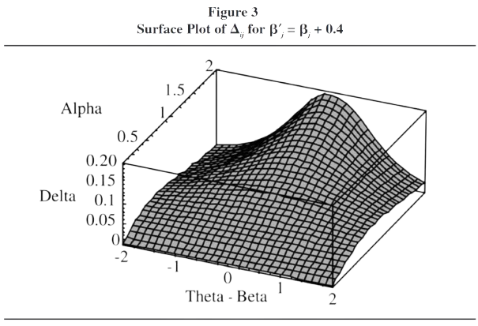
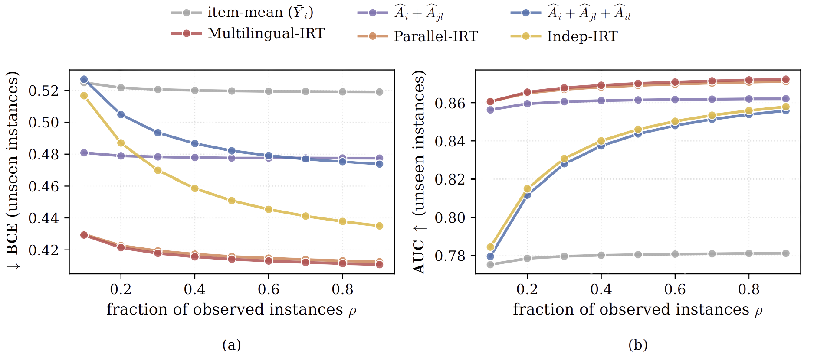

# Item Response Theory

## Table of Contents
1. [Glossary](#glossary)
2. [Models](#models)
3. [Optimization](#optimization)
4. [Scale-Linking](#scale-linking)
5. [Differential Item Functioning](#differential-item-functioning-dif)
6. [NLP Applications](#nlp-applications)

[Citations](#citations)

Item Response Theory explains the relationship between an individual's ability and their observed performance [(Columbia University Mailman School of Public Health, n.d.)](https://www.publichealth.columbia.edu/research/population-health-methods/item-response-theory). Formally, the probability of correctly answering an item is a function of the person's ability and visualized as the item response curve.

A person's "ability" and an item's parameters are organized on an unobservable continuum (Columbia University Mailman School of Public Health, n.d.). The main purpose of IRT is to establish an individual's position on that continuum [(Columbia University Mailman School of Public Health, n.d.)](https://www.publichealth.columbia.edu/research/population-health-methods/item-response-theory). 

## Glossary

| Term              | Definition                            |
|-------------------|---------------------------------------|
| $i$               | subject $i$                           |
| $j$               | item $j$                              |
| $\ell$            | language $\ell$                       |
| $N$               | number of subjects                    |
| $M$               | number of items                       |
| $L$               | number of languages                   |
| $a_j$             | (item) discrimination parameter       |
| $b_j$             | (item) difficulty parameter           |
| $c_j$             | (item) guessing parameter; the chance of a correct response for a very low $\theta$|
| $d_j$             | probability of endorsing an (item) incorrect answer in spite of high ability |
| $D=1.7$           | scaling constant                      |
| $\theta_i$        | (subject) ability. Formally cited as $\theta \in (-\infty, \infty)$, it more often is the case $\theta \in [-3, +3]$. An estimated ability of 1.2 can be interpreted as 1.2 standard deviations above the average ability in the population. |
| $\mathbf{r}_{ij}$ | response from subject $i$ to item $j$ |

## Assumptions

1. **Monotonicity**: As the trait level "increases," the probability of a correct response increases.
2. **Unidimensionality**: There is one dominant latent trait being measured and this trait is the driving force for the responses observed for each item in the measure.
3. **Local independence**: Responses given to separate items in a test are mutually independent given a certain level of ability.
4. **Invariance**: We can estimate item parameters from any position on the item response curve. Put another way, invariance means that item parameters do not depend on the characteristics of a particular population. Parameter invariance is crucial if one wants to carefully assess the degree of inferential generalizability across examinee populations; if parameters are not invariant, the statistical foundation for inferences is not identical across populations and hence the inferences are not generalizable across those to the same degree [(Rupp and Zumbo, 2006)](https://journals.sagepub.com/doi/10.1177/0013164404273942).

## Models
### Unidimensional, Dichotomous

| Parameter | Formula |
|-----------|---------|
| 1PL       | $\mathbb{P}[\mathbf{r}_{ij}=1 \mid \theta_i, b_j] = \frac{\exp(D(\theta-b_j))}{1+\exp(Da(\theta-b_j))} = \frac{1}{1+\exp[-Da(\theta_i-b_j)]}$ |
| 2PL       | $\mathbb{P}[\mathbf{r}_{ij}=1 \mid \theta_i, a_j, b_j] = \frac{\exp(\theta_i-b_j)}{1+\exp[a_j(\theta_i-b_j)]} = \frac{1}{1+\exp[-Da_j(\theta_i-b_j)]}$ |
| 3PL       | $\mathbb{P}[\mathbf{r}_{ij}=1 \mid \theta_i, a_j, b_j, c_j] = c_j + (1-c_j)\frac{1}{1+\exp[-Da_j(\theta_i-b_j)]}$ |
| 4PL       | $\mathbb{P}[\mathbf{r}_{ij}=1 \mid \theta_i, a_j, b_j, c_j, d_j] = c_j + (d_j-c_j)\frac{1}{1+\exp[-Da_j(\theta_i-b_j)]}$ |

## Optimization

*Notes on Joint Maximum Likelihood, conditional maximum likelihood, and marginal maximum likelihood are pulled from  [Johnson (2007)](https://www.jstatsoft.org/article/view/v020i10)*

### Joint Maximum Likelihood
The joint maximum likelihood (JML) estimation procedure treats both item parameters and ability as unknown but fixed model parameters.

$$
\left(\hat a, \hat b, \hat c, \hat d, \hat \theta \right) = \operatorname*{argmax}_{a, b, c, d, \theta} \mathcal{L}(a, b, c, d, \theta \mid \mathbf{R}) = \operatorname*{argmax}_{a, b, c, d, \theta} \prod_{i=1}^N \prod_{j=1}^M \mathbb{P}[\mathbf{r}_{ij}=1 \mid a_j, b_j, c_j, d_j, \theta_i]^{\mathbf{r}_{ij}} \left(1-\mathbb{P}[\mathbf{r}_{ij}=1 \mid a_j, b_j, c_j, d_j, \theta_i]\right)^{1-\mathbf{r}_{ij}}
$$

A unique solution exists if further constraints are placed on examinee and item parameters. For two parameters like the 2PL, two constraints are necessary
* a location constraint: constrain a single difficulty to some fixed dumber or the average difficulty to some number
* a scale constraint: force the product of the discrimination parameters to one $\prod_{j=1}^M a_j=1$.

Estimates are inconsistent (Neyman and Scott 1948; Andersen 1970; Ghosh 1995 from Marginal Maximum Likelihood Estimation of Item  Response Models in R by Matthew S Johnson); no matter how many individuals are included in the sample, the estimates may still be biased.

### Conditional Maximum Likelihood

[Andersen (1970)](https://academic.oup.com/jrsssb/article/32/2/283/7027105?login=false) proposed Conditional Maximum Likelihood (CML). This method conditions on the vector of raw scores $\mathbf{R}_{i+} = \sum_j \mathbf{r}\_{ij}$ which is a sufficient statistic and substitute for the abilities of individuals in the sample. 

[Andersen (1970)](https://academic.oup.com/jrsssb/article/32/2/283/7027105?login=false) shows that maximizing the objective below results in consistent item difficulties.

$$
\hat b = \operatorname*{argmax}_{b} \mathcal{L}(b \mid \mathbf{R}) = \operatorname*{argmax}_{b} \prod_{i=1}^N \mathbb{P}[\mathbf{r}_i \mid b, \mathbf{R}_{i+}] = \frac{\exp\left(-\sum_j \mathbf{r}_{ij} b_j\right)}{\sum_{\{\mathbf{y}\,:\, \sum_j y_j = \mathbf{R}_{i+}\}} \exp\left(-\sum_j y_j b_j\right)}
$$

Note that this does not depend on the individual's ability $\theta$. An ad hoc procedure must be implemented to estimate the ability of individuals. 

In addition, the conditional maximum likelihood only works when there is a simple sufficient statistic, like the raw score for the Rasch model. More complex IRT models, including the 2 PL, do not have simple sufficient statistics.

### Marginal Maximum Likelihood

Unlike joint maximum likelihood estimation techniques, the marginal maximum likelihood (MML) treats only $N$ individuals as the observational units. To accomplish this, MML assumes that abilities are sampled from some larger distributions denoted as $F(\theta)$. Typically, IRT modelers assume that the distribution F is the normal distribution with mean 0 and standard deviation 1. However the normal distribution does not necessarily work for all applications

$$
(\hat a, \hat b, \hat c, \hat d) = \operatorname*{argmax}_{a,b,c,d} \mathcal{L}(a, b, c, d \mid \mathbf{R}) = \prod_i \mathbb{P}[\mathbf{r}_{i} \mid a, b, c, d] = \prod_i \int_\theta L_i(\theta_i \mid \mathbf{r}_i, a, b, c, d)dF(\theta_i)
$$

Like the JML estimation method, location and scale constraints are required to achieve a unique solution. The constraints can either be placed on the means and standard deviation of the ability distribution $F(\theta)$ or on the item parameters.

### Variatonal Inference

[Wu et al. (2020)](https://web.stanford.edu/~cpiech/bio/papers/variationalItemResponseTheory.pdf) proposed **VIBO**, a **variational inference** method for fitting IRT models to large datasets. Applying this method to five large-scale item response datasets from cognitive science and education yields higher log likelihoods and improvements in imputing missing data.

The authors made the assumptions listed below

$\theta_i \in \mathbb{R}^{K} : \mathbb{P}[\theta_i] = \prod_{k=1}^K \mathbb{P}[\theta_{i,k}]$ where $\mathbb{P}[\theta_{i,k}] \sim \mathcal{N}(0,1)$

$\mathbb{P}[\\{a_j, b_j, c_j, d_j\\}_{j=1:M}] = \prod\_{j=1}^M \mathbb{P}[\{a_j, b_j, c_j, d_j\}]$ where $\mathbb{P}[\{a_j, b_j, c_j, d_j\}] \sim \mathcal{N}(0,1)$

$q_\phi(\\{a_j,b_j,c_j,d_j\\}_{j=1:M} \| \mathbf{r}\_{i,1:M}) = q\_\phi(\\{a_j,b_j,c_j,d_j \\}\_{j=1:M}) = \prod\_{j=1}^M q\_\phi(\\{a_j,b_j,c_j,d_j \\}\_{j=1:M})$

The goal of VIBO is to pick a family of distribution that "best approximates the true posterior by minimizing an estimate of mismatch between true and approximate distributions." Observed variable $x \in \mathcal{X}$ represents responses from a single student $\mathbf{r}_i$ and latent variables $z \in \mathbf{\mathcal{Z}}$ represents ability and item characteristics $\theta_i, \\{a_j,b_j,c_j,d_j\\}\_{j=1:M}$.

$$q_{\psi^*(x)}(z)=\operatorname*{argmin}_{q_{\psi(x)}} D_{\text{KL}}\big(q_{\psi(x)}(z),|,p(z|x)\big)=\operatorname*{argmax}_{\psi(x)}\mathbb{E}{q_{\psi(x)}(z)}\left[\log\frac{p(x,z)}{q_{\psi(x)}(z)}\right]$$

<i>by definition: minimizing the KL-divergence to the log posterior is equivalent to maximizing the ELBO</i>

Let $\mathbb{P}_D(x)$ be an empirical distribution over the observed variables. The average quality of the variational approximations is 

$$ \mathbb{E}_{\mathbb{P}_D(x)}\left[\max_{\psi(x)} \mathbb{E}_{q_{\psi(x)}(z)}\left[\frac{\mathbb{P}[x,z]}{q_{\psi(x)}(z)}\right]\right] $$

Learning an approximate posterior for each $x \in D$ can grow to be unwieldy in a large dataset. [Wu et al. (2020)](https://web.stanford.edu/~cpiech/bio/papers/variationalItemResponseTheory.pdf) proposed an amortized function $f_\phi$ (parameterized by $\phi$) that maps a person's responses directly to parameters of their approximate posterior distribution. The number of parameters in amortization is vastly smaller than learning a per-observation posterior.

$$ \max_\phi \mathbb{E}_{\mathbb{P}_D(x)}\left[\mathbb{E}_{q_\phi(z|x)}\left[\log \frac{\mathbb{P}[x,z]}{q_\phi(z|x)}\right]\right] $$

[Wu et al. (2020)](https://web.stanford.edu/~cpiech/bio/papers/variationalItemResponseTheory.pdf) proved that VIBO is a lower bound on the log marginal probability of person $i$'s response. 

$$
\begin{flalign}
\log \mathbb{P}_\theta[\mathbf{r}_{i,1:M}] \ge \text{VIBO} &\triangleq \mathcal{L}_{\text{recon}} + \mathbb{E}_{q_\phi(\{a_j,b_j,c_j,d_j\}_{j=1:M}|\mathbf{r}_{i,1:M})}[D_{\text{ability}}] + D_{\text{item}} \\
\mathcal{L}_{\text{recon}} &= \mathbb{E}_{q_\phi(\theta_i, \{a_j, b_j, c_j, d_j\}_{j=1:M}|\mathbf{r}_{i,1:M})}\left[\log \mathbb{P}_\theta[\mathbf{r}_{i,1:M}|\theta_i, \{a_j, b_j, c_j, d_j\}_{j=1:M}]\right] \\
D_{\text{ability}} &= D_{\text{KL}}\left(q_\phi(\theta_i|\{a_j,b_j,c_j,d_j\}_{j=1:M}, \mathbf{r}_{i,1:M})\|\mathbb{P}[\theta_i]\right)\\
D_{\text{item}} &= D_{\text{KL}}(q_\phi(\{a_j,b_j,c_j,d_j\}_{j=1:M}|\mathbf{r}_{i,1:M})\|\mathbb{P}[\{a_j,b_j,c_j,d_j\}_{j=1:M}])\\
\end{flalign}
$$

and estimated the gradients with respect to $\theta$ and $\phi$.

$$
\begin{flalign}
\nabla_\theta\text{VIBO} &= \nabla_\theta\mathcal{L}_{\text{recon}} \\
&= \mathbb{E}_{q_\phi(\theta_i, \{a_j,b_j,c_j,d_j\}_{j=1:M})}[\nabla_\theta\log\mathbb{P}_\theta[\mathbf{r}_{i,1:M}|\theta_i, \{a_j,b_j,c_j,d_j\}_{j=1:M}]] \\
\nabla_\phi\text{VIBO} &= \nabla_\phi \mathbb{E}_{q_\phi(\{a_j,b_j,c_j,d_j\}_{j=1:M}|\mathbf{r}_{i,1:M})}[D_\text{ability}] + \nabla_\phi D_{\text{item}} \\
&= \nabla_\phi\mathbb{E}_{q_\phi(\theta_i, \{a_j,b_j,c_j,d_j\}_{j=1:M})} \left[\frac{\mathbb{P}[\theta_i]\mathbb{P}[\{a_j,b_j,c_j,d_j\}_{j=1:M}]}{q_\theta(\theta_i, \{a_j,b_j,c_j,d_j\}_{j=1:M}|\mathbf{r}_{i,1:M})}\right] \\
\end{flalign}
$$

### Pseudo-Siamese Neural Estimator
The Pseudo-Siamese Network for IRT (PSN-IRT) architecture comprises of two independent networks:
* model network: processes one-hot encoded LLM identifies to estimate model-ability $\theta$
* item network: processes one-hot encoded item identifiers to produce discrimination $a$, difficulty $b$, guessing $c$, and inattention $d$

## Scale Linking

*The summary below is pulled directly from [Kim and Lee (2004)](https://www.act.org/content/dam/act/unsecured/documents/ACT_RR2004-5.pdf) unless otherwise stated. The paper extends linkage methods to mixed-format tests (e.g. multiple choice or short essay questions). The documentation below has been modified to account for only dichotomous tests.* **[Kim and Lee (2004)](https://www.act.org/content/dam/act/unsecured/documents/ACT_RR2004-5.pdf) found that characteristic curve method yield more linking results than moment methods.**

| Term | Definition |
| ---- | ---------- |
| $A, B$ | (scale) linking coefficients slope and intercept, respectively |
|$\Psi(\theta_{\texttt{old}}), \Psi(\theta_{\texttt{new}})$ | continuous distributions of $\theta_{\texttt{old}}$ and $\theta_N$ respectively |
| $\hat T(\cdot)$ | test characteristic function (an aggregation of item characteristic curves) |

### Motivation

Aside: Because the latent (ability) scale in IRT model is arbitrary, (unlinked) item and examinee parameters are identical only up to a set of linear transformations listed below (Lord, 1980; [Rupp and Zumbo, 2006](https://journals.sagepub.com/doi/10.1177/0013164404273942)). Let $*$ item and examinee parameters represent "new" parameters. Below is an informal proof of equivalence.
* $\theta^* = A\theta + B$
* $a^* = a/A$
* $b^* = Ab+B$
* $c^* = c$

$$
\begin{flalign*}
\mathbb{P}[\mathbf{r}_{ij}=1 | \theta_i, a_j, b_j, c_j] &= c_j + (1-c_j)\frac{1}{1+\exp[-Da_j(\theta_i-b_j)]} && \text{original item characteristic curve} \\
\mathbb{P}[\mathbf{r}_{ij}=1 | \theta_i^*, a_j^*, b_j^*, c_j^*] &= c_j^* + (1-c_j^*)\frac{1}{1+\exp[-Da_j^*(\theta_i^* - b_j^*)]} \\
&= c_j + (1-c_j) \frac{1}{1+\exp\left[-D \frac{a_j}{A}(A(\theta_i+\cancel{B})-(Ab_j-\cancel{B}))\right]} && \text{by substitution} \\
&= c_j + (1-c_j) \frac{1}{1+\exp\left[-D \frac{a_j}{\cancel{A}}(\cancel{A}(\theta_i+b_j))\right]} \\
&= c_j + (1-c_j)\frac{1}{1+\exp[-Da_j(\theta_i-b_j)]} \\
&= \mathbb{P}[\mathbf{r}_{ij}=1 | \theta_i, a_j, b_j, c_j] \\
\end{flalign*}
$$

Consider a situation in which two populations of examinees: $\texttt{old}$ and $\texttt{new}$, take a "test," and their response data is later trained to train two separate IRT models. When item parameters are estimated separately for two groups, item parameters are expressed on different measure scales ([Battauz, 2017](https://dies.uniud.it/it/ricerca/allegati_wp/wp_2017-1/wp03_2017.pdf)). Before comparing item parameter estimates derived from different groups, it is necessary to "transform" them to obtain values expressed on the same "metric" ([Battauz, 2017](https://dies.uniud.it/it/ricerca/allegati_wp/wp_2017-1/wp03_2017.pdf)).

$$
\begin{flalign}
\theta_{\texttt{old}} &= A\theta_{\texttt{new}} + B && \text{$\theta_{\texttt{old}}$ and $\theta_{\texttt{new}}$ are group dependent but should be linearly related because of invariance assumption (Lord, 1980)}\\
a_{j, \texttt{old}} &= a_{j, \texttt{new}} / A && \text{$j$th item discrimination parameter on old $\theta_{\texttt{old}}$ and new scale $\theta_{\texttt{new}}$} \\
b_{j, \texttt{old}} &= Ab_{j, \texttt{new}} + B \\
c_{j, \texttt{old}} &= c_{j, \texttt{new}} && \text{$c_j, d_j$ are independent of ability $\theta$ and are not affected by the linear transformation}\\
d_{j, \texttt{old}} &= d_{j, \texttt{new}} \\
\end{flalign}
$$

### Moment Methods
**Mean/mean method**
$$
\begin{flalign}
A_{\texttt{mean/mean}} &= \frac{\texttt{mean}(\hat a_{\texttt{new}})}{\texttt{mean}(\hat a_\texttt{old})} \\
B_{\texttt{mean/mean}} &= \texttt{mean}(b_\texttt{old}) - A_{\texttt{mean/mean}}\texttt{mean}(\hat b_{\texttt{new}})
\end{flalign}
$$

**Mean/sigma method**
$$
\begin{flalign}
A_{\texttt{mean/sigma}} &= \frac{\texttt{standard_deviation}(\hat b_{\texttt{old}})}{\texttt{standard_deviation}(\hat b_{\texttt{new}})} \\
B_{\texttt{mean/sigma}} &= \texttt{mean}(\hat b_{\texttt{old}}) - A_{\texttt{mean/sigma}} \texttt{mean}(\hat b_{\texttt{new}})
\end{flalign}
$$

### Characteristic Curve Methods

To develop characteristic curve methods, the item characteristic curve or a test characteristic curve on the new (ability) scale is transformed with its "counterpart" on the old scale, and vice versa. This transformation requires item parameter estimates on one scale to be expressed as those transformed to the other; two ways of transformation &mdash;new-to-old and old-to-new&mdash;are conducted.

Such transformations vary by IRT model; item parameter estimate transformations for 3PL models are as follows

$$
\begin{flalign}
    \texttt{new}\rightarrow\texttt{old} &: \hat a^*_{j,\texttt{new}} = \frac{\hat a_{j, \texttt{new}}}{A} \hspace{5em} \hat b^*_{j, \texttt{new}} = A\hat b^*_{j, \texttt{new}} + B \\
    \texttt{old}\rightarrow\texttt{new} &:  \hat a^{\#}_{j, \texttt{old}} = A\hat a_{j, \texttt{old}} \hspace{5.5em} \hat b^{\#}_{j, \texttt{old}} = \frac{\hat b_{j, \texttt{old}} - B}{A}
\end{flalign}
$$

[Robitzsch (2024)](https://www.mdpi.com/2571-8800/7/3/21) explored asymptotic bias[^1] of the Haebara and Stocking-Lord linking methods for the 2PL IRT model. **The Stocking-Lord linking method had substantial advantages over Haebara linking** in the presence of differential item functioning (described [here](#differential-item-functioning-dif)).

**Haebara method**

**Stocking-Lord method**: The criterion function $F$ has been defined to be non-symmetric so that only the target scale (i.e. $\theta_{\texttt{old}}$ in the case of new-to-old transformations) is taken into account. It may be desirable that the transformed scale (i.e. $\theta_{\texttt{new}}$ in the case of new-to-old transformation) also be taken into account, making $F$ symmetric.

| Formulation     | Approximation                 |
| --------------- | ----------------------------- |
| $F = F_1 + F_2$ | $F \cong F^* = F_1^* + F_2^*$ |
| $F_1 = \int_{-\infty}^{+\infty} \left[\hat T(\theta_{\texttt{old}}) - \hat T^*(\theta_{\texttt{old}})\right]^2 \Psi_1(\theta_{\texttt{old}}) d\theta_{\texttt{old}}$ | $F_1^* = \frac{1}{L^*} \sum_{i=1}^{N_{\texttt{old}}} \left[ \hat T(\theta_{i,\texttt{old}}) - \hat T^{\ast}(\theta_{i, \texttt{old}}) \right]^2 W_1(\theta_{i, \texttt{old}})$ |
| $F_2 = \int_{-\infty}^{+\infty} \left[ \hat T(\theta_{\texttt{new}}) - \hat T^{\\#}(\theta_{\texttt{new}}) \right]^2 \psi_2(\theta_{\texttt{new}})d\theta_{\texttt{new}}$ | $F_2^* = \frac{1}{L_2^*} \sum_{i=1}^{N_{\texttt{new}}}\left[\hat T(\theta_{i, \texttt{new}}) - \hat T^{\\#}(\theta_{i, \texttt{new}})\right]^2 W_2(\theta_{i, \texttt{new}})$ |

$$
\begin{flalign}
    \hat T(\theta_{\texttt{old}}) &= \sum_{j=1}^M \hat {\mathbb{P}}_{j, \texttt{old}}[\theta_{\texttt{old}}], \hspace{5em} \hat T^{*}(\theta_{\texttt{old}}) = \sum_{j=1}^M \hat {\mathbb{P}}_{j, \texttt{new}}[\theta_{\texttt{old}}] \\
    \hat T(\theta_{\texttt{new}}) &= \sum_{j=1}^M \hat{\mathbb{P}}_{j, \texttt{new}}[\theta_{\texttt{new}}], \hspace{6em} \hat{T}^{\#}(\theta_{\texttt{new}}) = \sum_{j=1}^M \hat{\mathbb{P}}_{j, \texttt{old}}[\theta_{\texttt{new}}]
\end{flalign}
$$

## Invariance

The success of IRT applications requires satisfactory fit between model and data [(Kang and Chen, 2007)](https://www.act.org/content/dam/act/unsecured/documents/ACT_RR2007-1.pdf). The most critical problem caused by model misfit may be that the hallmark feature of IRT, parameter invariance, no longer applies ([Shepard, Camilli, and Williams, 1984](https://journals.sagepub.com/doi/10.3102/10769986009002093); [Bolt, 2002](https://www.tandfonline.com/doi/abs/10.1207/S15324818AME1502_01); [Rupp and Zumbo, 2004](https://journals.sagepub.com/doi/10.1177/0013164403261051)).

### Item Invariance

Item parameters drift consitutes a lack of invariance at the individual item level or item set level. When lack of invariance effects are expressed with respect to response probabilities, it appears quite complex because of the curvature and asymptotic behavior of the ICCs [(Rupp and Zumbo, 2006)](https://journals.sagepub.com/doi/10.1177/0013164404273942).

$$
\Delta_{ij} = \mathbb{P}_j[\mathbf{r}_{ij}=1|\theta_i, a_j, b_j, c_j, d_j] - \mathbb{P}_j[\mathbf{r}_{ij}=1|\theta_i', a_j', b_j', c_j', d_j']
$$

It is possible to plot the $\Delta_{ij}$ values to illustrate this complex behavior more closely.

where $\texttt{Alpha}$ refers to $a_j$, $\texttt{Delta}$ refers to $\Delta_{ij}$, and $\texttt{Theta - Beta}$ refers to $\theta_i - b_j$. This allow researchers to quickly gauge the severity of the lack of invariance effects on the logit and probability scales and from a practical viewpoints, allows one to compute and visualize different lack of invariance effects on response probabilities and examinee true scores.

### Measurement Invariance (Factorial Invariance)

**Excerpt from the preface of *Statistical Approaches to Measurement Invariance [(Millsap, 2011)](https://www.taylorfrancis.com/books/mono/10.4324/9780203821961/statistical-approaches-measurement-invariance-roger-millsap)*** *The question of bias detection is partially solved...We have no completely general method for detecting bias in psychological measures that work across all of the many measurement conditions encountered in psychology. Instead, we have collection of approaches that apply under specific conditions and assumptions, and that may not function well when these conditions or assumptions are violated. A further problem is that it is usually hard to verify some of the assumptions that are needed in practice for many of the detection methods.*

A test is measurement invariant if examinees with **the same level of the (ability) attribute** have the same expected scores, regardless of the group to which they belong. As a result, any differences in test scores between groups reflect genuine differences in the attribute rather than differences in how the test functions across groups.

**Why does [Millsap (2011)](https://www.taylorfrancis.com/books/mono/10.4324/9780203821961/statistical-approaches-measurement-invariance-roger-millsap) insist on the same level of ability**: Bias in measurement is equivalent to systematic replicable inacurracy. Once the question of bias is raised, trying to answer the question by simply documenting group differences in item scores is **futile**. It may be that all of the following is true
* the groups do differ systematically on the attribute beain measured
* the test item yields scores that systematically differ across groups
* the test is biased

If we consider group differences in item scores in the general population without matching on the attribute being measured, we may encounter systematic group differences in item scores even when the item is unbiased. It is thus essential that we compare individuals from different groups who are "**matched**" on the attribute being measured. (CAVEAT EMPTOR: These two individuals who have been matched on the attribute being measured may still achieve different scores on the test item even when the item is unbiased.)

**Relation to test reliability**: A test that is reliable may, or may not, be biased. An unreliable test may yield unbiased measurement in an average sense across repeated measurement. A biased test may be highly reliable yet may consistently provide inaccuratement even when the average of many repeated measurements is considered.

#### Methods of Quantifying Measurement Invariance (Factorial Invariance)

**Multigroup confirmatory factor analysis (MGCFA)**: To test measurement invariance across groups of participants, researchers commonly use multigroup confirmatory factor analysis (MGCFA). MGCFA first examines whether the factor structure specified by a questionnaire (the number of latent factors and which items belong to each) holds in every group being compared. It then tests whether the groups share more specific measurement properties, such as how strongly each item relates to its factor. To do this, researchers divide the sample into groups (e.g., young adults, middle-aged adults, and older adults) and fit the model to all groups simultaneously, adding equality constraints across groups in successive steps and checking whether model fit worsens. The three typical phases of measurement invariance testing are as follows:

| Step | What gets constrained | Consequences |
| ---- | --------------------- | ------------ |
| 1. Configural Invariance | Leave all **factor loadings** (te strength of each scale item-latent factor relationship) and **item intercepts** (each item's origin value) | a good multi-group model fit suggests that the overall factor structure holds up similarly for all groups |
| 2. Metric Invariance | Constrain the factor loadings to be equivalent across all groups, while still allowing the item intercepts to vary | If constraining the factor loadings results in a poorer fit, factor loadings *may* not be similar across age groups. Validation of metric invariance indicates that each item loads into the specified latent ability factor in a similar manner and with similar magnitude across groups. |
| 3. Scalar Invariance | Constrain the factor loadings and item intercepts to be equivalent across groups. | If constraining the factor intercepts results in a poorer fit, item intercepts *may* not be similar across groups.|

Scientists stop testing when any of these steps produces evidence of noninvariance. Scientists would then examine the factor loadings and item intercepts on an item-by-item basis to determine which items are the main contributors toward measurement invariance.

**Regression and Correlation Methods**: The lack of group differences in regressions or correlations has been cited as evidence that measurement bias, if it exists, does not have any practical impact. However, [Borsboom, Romejin, and Wicherts (2008)](https://pubmed.ncbi.nlm.nih.gov/18557679/), [Millsap (1997)](https://psycnet.apa.org/record/1998-04950-002), [Millsap (1998)](https://www.tandfonline.com/doi/abs/10.1207/s15327906mbr3303_5), [Millsap (2007)](https://link.springer.com/article/10.1007/s11336-007-9039-7) assert that a test may show identical regressions when it is used to predict a criterion measure across multiple populations, even though substantial measurement bias exists in the test. 

#### Devil's Advocate
Whatever measurement bias may be present has little impact on the use of tests in prediction or selection ([Neisser et al, 1996](https://psycnet.apa.org/record/1996-02655-001); [Sackett et al, 2008](https://psycnet.apa.org/record/2008-05553-001))

#### Significance

Aside from the arguments of fairness and equitable treatment, validation of measurement invariance ensures that comparisons across various groups of participants are both meaningful and valid. When a test item is found to function differently dependin on the examinee's group membership, questions are raised about what the item is actually measuring. Researchers can (i) get rid of the item or (ii) generate hypoteses about the sources of the bias and test those hypotheses by strategically selecting items to manifrest hypothesized biases.

### Item Bias

A good portion of literatured has used "differential item functioning" to refer to "item bias," an **older** term. The use of bias has a **negative connotation**, implying that the item may be unfair or prejudiced (Angoff, 1993).

An item is **unbiased** in relation to groups if the probability of attaining any particular score on the item is the same for the two individuals. 

### Differential Item Functioning (DIF)

DIF is a **violation of the invariance assumption in IRT** and occurs when the probability of a positive response for examinees at the same ability level varies in different groups (e.g. age, ethnicity, gender, education) ([Battauz, 2017](https://dies.uniud.it/it/ricerca/allegati_wp/wp_2017-1/wp03_2017.pdf); <a id="ref-columbia-uni-dif">[Columbia University Mailman School of Public Health, n.d.](#columbia-uni-dif)). DIF terminology confines itself to **statistical finding** of different performance for the **item** across groups. The contrast between DIF and item bias exists to separate the statistical pheomenon (group differences that remain after attempted matching) from questions about what the explanation for the phenomenon might be. The distinction between DIF and item bias separates a statistical finding from its interpretation.

### DIF Types

|   | Benign DIF [(Breslau et al, 2008)](https://pmc.ncbi.nlm.nih.gov/articles/PMC2748987/) | Adverse DIF [(Breslau et al, 2008)](https://pmc.ncbi.nlm.nih.gov/articles/PMC2748987/) |
| - | ---------- | ----------- |
| groups differ in their probabilities of endorsing at item because ... | the item taps a dimension of the underlying ability between groups | artifactual elements in the measurement process (e.g. different understandings of a word/phrase) |
| reflects | real group differences in ability | biases in the measurement process |

There are no unambiguous quantitative methods to distinguish benign from adverse DIF [(Columbia University Mailman School of Public Health, n.d.)](https://www.publichealth.columbia.edu/research/population-health-methods/differential-item-functioning). Qualitative methods, such as focus groups, interviews, and careful revies of items by content experts, can minimize the degree of differential item functioning [(Columbia University Mailman School of Public Health, n.d.)](https://www.publichealth.columbia.edu/research/population-health-methods/differential-item-functioning).

### Methods of Quantifying DIF

**Likelihood Ratio Test** The likelihood ratio test (LRT) was proposed by Thissen, Steinberg, and Wainer (1988, 1993) to determine statistical significant differential functioning. The most common approach to the LRT is the constrained baseline approach in which all other itema are used as anchor items (AOAA). The LRT compares 
* the fit (i.e., the likelihood) of a compact model in which all item parametersare assumed to be equal across both groups with
* the fit of an augmented model in which all item parameters are assumed to be equal for two group **except for one item**

A significance test of DIF can be conducted by the $X^2$ statistic:

$$
X^2 = -2(\ln L_c - \ln L_A)
$$

where
* $df$ is the degrees of freedom (i.e. number of item parameters)
* $\ln L_C$ is the log likelihood of the compact model
* $\ln L_A$ is the log likelihood of the argment model

an item exhibits significant DIF when $X^2$ exceeds a critical value of the $\chi^2$ distribution at a prespecified level of Type I error. This means that the augmented model fits better than the compact model for the selected item, suggesting that it is better to use different parameters in both groups on that specific item.

*Limitations*: To obtain the best results with LRT, the anchor items--items that are "invariant" across groups--should be non-significant differential functioning items across groups [(Cheung & Rensvold, 1999)](https://www.sciencedirect.com/science/article/pii/S0149206399800014). Unfortunately, with real data, such items are almost always unknown. A large drawback of the LRT and AOAA is inflated Type I error rates because items that are functioning differently across groups are also used as anchor items ([Kim and Cohen, (1995)](https://www.tandfonline.com/doi/abs/10.1207/s15324818ame0804_2); [Lautenschlager, Flaherty, and Park, (1994)](https://journals.sagepub.com/doi/10.1177/0013164494054001003); [Navas-Ara and Gomex-Benito (2002)](https://psycnet.apa.org/record/2002-00603-002)).

*Selecting Anchor Items--Alternatives to the AOAA*: [Lopez Rivas et al (2009)](https://journals.sagepub.com/doi/10.1177/0146621608321760) recommended the "maxA5" approach; select five items with the argest $a$ parameters. [Woods (2009)](https://journals.sagepub.com/doi/10.1177/0146621607314044) suggested the rank-based strategy; an LRT is first conducted with an AOAA and items are ranged based on the $X^2$ value. Select 10-20% of items with the smallest $X^2$ value. [Egerbrink et al (2014)](https://pmc.ncbi.nlm.nih.gov/articles/PMC5965504/) recommended using [Woods (2009)](https://journals.sagepub.com/doi/10.1177/0146621607314044) rank-based strategy to select anchor items when investigating differential functioning in large samples. 

**Mantel-Haenszel**

*Limitations*

**Item Probabilities**: If the parameter values or item response functions are identical in both populations, then the probabilities of responding to a category are the same and therefore the item is DIF-free [(Wells, 2021)](https://www.cambridge.org/core/books/abs/assessing-measurement-invariance-for-applied-research/methods-based-on-item-response-theory/AF361F6D9AE0D8FC860488D1A7617B49).

**Lord's $\mathcal{X}^2$ test (Lord, 1980)**: Note that $^*$ refers to the scale linked version. Formulation follows [Battauz (2017)](https://dies.uniud.it/it/ricerca/allegati_wp/wp_2017-1/wp03_2017.pdf)

$$
H_0: v_{j, \texttt{old}} = v^*_{j, \texttt{new}} \equiv \begin{pmatrix} a_{j, \texttt{old}} \\ b_{j, \texttt{old}} \\ c_{j, \texttt{old}} \end{pmatrix} = \begin{pmatrix}a^*_{j, \texttt{new}} \\ b^*_{j, \texttt{new}} \\ c^*_{j, \texttt{new}}\end{pmatrix}
$$

$$
\mathcal{X}_j^2 = \left(v_{k,\texttt{old}} - v^*_{j,\texttt{new}}\right)^T\left(\Sigma_{j, \texttt{old}}+\Sigma_{j, \texttt{new}}\right)^{-1}\left(v_{j,\texttt{old}}-v_{j, \texttt{new}}\right)
$$ where $\Sigma_{j, \texttt{old}}$ and $\Sigma_{j, \texttt{new}}$ represent the estimate covariance matrix for $v_{j, \texttt{old}}$ and $v_{j, \texttt{new}}$ respectively.

*Reviews*: [Kim and Cohen (2009)](https://www.tandfonline.com/doi/epdf/10.1207/s15324818ame0804_2?needAccess=true) compared Lord's $\mathcal{X}^2$, Raju's area measures and the likelihood ratio test on a university mathematics placement test and found that there was close agreement among the three DIF detection procedures. However, Lord's $\mathcal{X}^2$ statistic was more effective at detecting simulated DIF than the two Z-tests of Raju's area [Kim and Cohen (2009)](https://www.tandfonline.com/doi/epdf/10.1207/s15324818ame0804_2?needAccess=true). The Z test for the exact signed area was the least effective and was most likely to result in false negative errors [Kim and Cohen (2009)](https://www.tandfonline.com/doi/epdf/10.1207/s15324818ame0804_2?needAccess=true).

## NLP Applications

[Lalor et al (2016)](https://aclanthology.org/D16-1062.pdf) questioned whether all items in a given test set are equal with regards to difficulty and discrimination power. They used Amazon Mechanical Turk works to annotate a sample of the Stanford Natural Language Inference Recognizing Textual Entailment. Researchers demonstrated IRT's application to evaluating NLP systems. They trained an IRT model on human data to compare NLP system performance with the performance in a human population.

[Lalor et al (2020)](https://aclanthology.org/D18-1500.pdf) experimented on Natural Language Inference and Sentiment Analysis to show that the likelihood of answering a question correctly is impacted by the question difficulty. Logistic regression models used training set size and item difficulty as parameters to predict whether a deep neural network would label an item correctly. Neural model performance starts to look more human; as DNNs are trained with more data, "easy" examples are learned more quickly than hard examples.

[Lior et al (2026)](https://arxiv.org/pdf/2606.15643) defined an IRT model suited for multilingual parallel benchmarks.

For
* a language-invariant discriminability component $a_j^{\text{base}}$
* a language-*dependent* discriminability component $a_j^{\text{lang}}$ captures the separation introduced by the language-specific residual  $\epsilon_{i\ell}$
* an LLM's (i.e., the test taker) language-specific ability residual $\left(\epsilon_i\right)_\ell$ captures how an LLM's proficiency in language $\ell$ differs from the overall ability $\theta_i$
* $b_j$
* an item's language specific difficulty deviation $d_{j\ell}$ lets the item's difficulty vary across languages, reflecting how translation can make the same question harder in different languages

the response $r_{ij\ell} \in \\{0,1\\}$ of LLM $i$ on item $j$ in language $\ell$ is modeled as: $r_{ij\ell} \sim \operatorname{Bernoulli}(p_{ij\ell})$. The probability of correctness every (item, LLM, language) instance $p_{ij\ell}$ is modeled as

$$
\text{logit}(p_{ij\ell}) = \ln\left(\frac{p_{ij\ell}}{1-p_{ij\ell}}\right) = a_j^{\text{base}} \theta_i + a_j^{\text{lang}}\left(\epsilon_i\right)_\ell - (b_j + d_{j\ell})
$$

subject to the sum-to-zero constraints: $\sum_{\ell=1}^L d_{j\ell} = 0, \sum_{\ell=1}^L \left(\epsilon_j\right)_\ell=0$

Prediction scores over unseen (item, LLM, language) instances, as a function of the fraction of seen instances. Two complementary metrics are shown: (a) Binary Cross Entropy (BCE) and (b) ROC-AUC. *Coupled-IRT*'s curve entirely overlaps with *Parallel-IRT* and so is not visible. The accuracy-based non-parametric baselines are computed directly on $\widehat Y\_{ij\ell}$. The baselines are: (1) per-item mean, $\widehat p\_{ij\ell} = \widehat Y\_{i} = \operatorname*{mean}\_{j,\ell} \widehat Y\_{ij\ell}$; (2) logit-additive model $\widehat p\_{ij\ell} = \widehat A\_i + \widehat A_{j\ell}$; and (3) logit-additive model with a per-(item-language) term $\widehat p_{ij\ell} = \widehat A\_i + \widehat A\_{j\ell} + \widehat A_{i\ell}$. 

*Note that the figure above is taken from the original paper, which reversed the subject and item roles of $i$ and $j$.*

### Spurious Correlations
Models can achieve strong results by simply using the hypothesis of a premise-hypothesis pair and ignoring the premise entirely ([Gururangan et al, 2018](https://aclanthology.org/N18-2017.pdf), [Tsuchiya (2018)](https://aclanthology.org/L18-1239.pdf), [Poliak et al (2018)](https://aclanthology.org/S18-2023.pdf))

## Citations

Andersen (1970). [Asymptotic Properties pf Conditional Maximum-Likelihood Estimators](https://www.jstor.org/stable/2984535)

Battauz (2017). [On Wald Tests for Differential item Functioning Detection](https://dies.uniud.it/it/ricerca/allegati_wp/wp_2017-1/wp03_2017.pdf)

Bolt. (2002) [A Monte Carlo Comparison of Parametric and Nonparametric Polytomous DIF Detection Methods](https://www.tandfonline.com/doi/abs/10.1207/S15324818AME1502_01)

Breslau et al. (2008) [Differential item functioning between ethnic groups in the epidemiological assessment of depression](https://pmc.ncbi.nlm.nih.gov/articles/PMC2748987/)

Columbia University Mailman School of Public Health. (n.d.) [Differential Item Functioning](https://www.publichealth.columbia.edu/research/population-health-methods/differential-item-functioning) [↩](#ref-columbia-uni-dif)

Columbia University Mailman School of Public Health. (n.d.). [Item Response Theory](https://www.publichealth.columbia.edu/research/population-health-methods/item-response-theory).

Gururangan et al (2018). [Annotation Artifacts in Natural Language Inference Data](https://aclanthology.org/N18-2017.pdf)

Johnson (2007). [Marginal Maximum Likelihood Estimation of Item Response Models in R](https://www.jstatsoft.org/article/view/v020i10).

Kang and Chen (2007). [An Investigation of the Performance of the Generalized S-$X^2$ Item-Fit Index for Polytomous IRT Models](https://www.act.org/content/dam/act/unsecured/documents/ACT_RR2007-1.pdf)

Kim and Cohen (2009). [A Comparison of Lord's Chi-Square, Raju's Area Measures, and the Likelihood Ratio Test on Detection of Differential Item Functioning](https://www.tandfonline.com/doi/epdf/10.1207/s15324818ame0804_2?needAccess=true)

Kim and Lee (2004). [IRT Scale Linking Methods for Mixed-Format Tests](https://www.act.org/content/dam/act/unsecured/documents/ACT_RR2004-5.pdf)

Lalor et al (2016). [Building an Evaluation Scale using Item Response Theory](https://aclanthology.org/D16-1062.pdf)

Lalor et al (2020). [Understanding Deep Learning Performance through an Examination of Test Set Difficulty: A Psychometric Case Study](https://aclanthology.org/D18-1500.pdf)

Lior et al (2026). [Extending Item Response Theory for Efficient and Meaningful Multilingual Evaluation](https://arxiv.org/pdf/2606.15643)

Lord (1980) Applications of item response theory to practical testing problems.

Poliak et al (2018). [Hypothesis Only Baselines in Natural Language Inference](https://aclanthology.org/S18-2023.pdf)

Robitzsch (2024). [Bias-reduced Haebara and Stocking-Lord Linking in the Presence of Differential Item Functioning](https://www.mdpi.com/2571-8800/7/3/21)

Raju. (1988) [The area between two item characteristic curves](https://link.springer.com/article/10.1007/BF02294403)

Rupp and Zumbo. (2004) [A note on how to quantify and report whether IRT parameter invariance holds: When Pearson correlations are not enough](https://journals.sagepub.com/doi/10.1177/0013164403261051)

Rupp and Zumbo. (2006) [Understanding Parameter Invariance in Unidimensional IRT Models](https://journals.sagepub.com/doi/10.1177/0013164404273942) 

Selçuk and Demir (2024) [Comparison of item response theory ability and item parameters to classical and Bayesian estimation methods](https://files.eric.ed.gov/fulltext/EJ1440215.pdf)

Shepard, Camilli, and Williams, (1984). [Accounting for Statistical Artifacts in Item Bias Research](https://journals.sagepub.com/doi/10.3102/10769986009002093)

Tsuchiya (2018). [Performance Impact Caused by Hidden Bias of Training Data for Recognizing Textual Entailment](https://aclanthology.org/L18-1239.pdf)

Weber et al. (2026) [The stability of IRT parameters under several test equating conditions](https://www.frontiersin.org/journals/psychology/articles/10.3389/fpsyg.2025.1652341/full) [↩](#ref-weber-et-al-2026)

Wells (2021). [Methods Based on Item Response Theory](https://www.cambridge.org/core/books/abs/assessing-measurement-invariance-for-applied-research/methods-based-on-item-response-theory/AF361F6D9AE0D8FC860488D1A7617B49)

Wu et al (2020). [Variational Item Response Theory: Fast, Accurate, and Expressive](https://web.stanford.edu/~cpiech/bio/papers/variationalItemResponseTheory.pdf)

***
[^1]: Asymptotic bias refers to the error between an expected statistical estimate and the true population value when the sample size grows infinitely large. 

